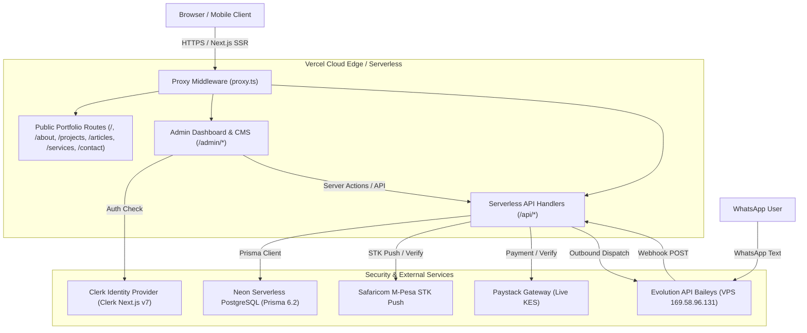
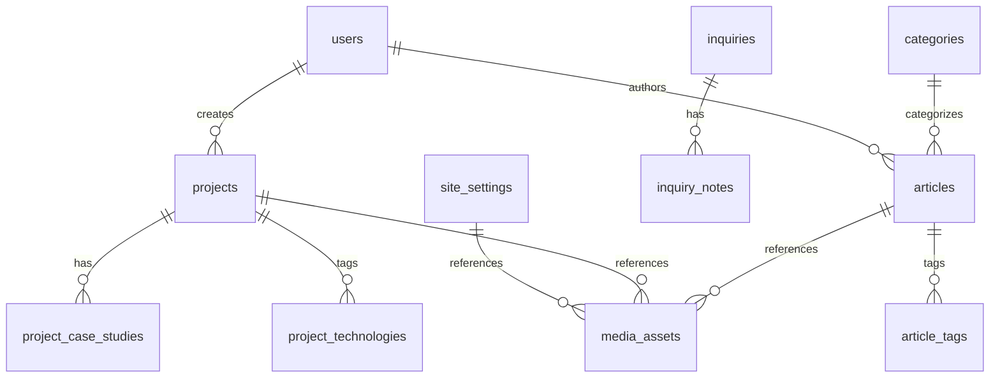

# System Architecture: Akubrecah Portfolio & CMS Platform

**Version:** 2.0 (Integrated Next.js 16 + Prisma + Clerk + Admin CMS)  
**Status:** Approved Architecture Blueprint  

---

## 1. High-Level System Architecture

---

## 2. Core Architectural Principles

1. **Monolithic Cohesion (No Disconnected Templates):**
   - The Public Portfolio and Admin Dashboard live within the exact same Next.js App Router codebase.
   - They share design tokens, Radix UI components, database clients (`@/lib/prisma`), and authentication utilities.
   - Content updated in the Admin CMS updates the public website instantly without rebuilding or redeploying code.

2. **Strict Data Boundary & Security Isolation:**
   - **Public Pages:** Retrieve exclusively published records (`where: { isPublished: true, publishedAt: { lte: now } }`).
   - **Admin API Handlers:** Guarded server-side by `verifyAdminCaller(req)` in `@/lib/admin-auth`. Non-admins receive `401 Unauthorized` or `403 Forbidden`.
   - **Zero Secret Leakage:** Database connection strings, Clerk secret keys, Paystack secret keys, and Evolution webhook secrets exist solely in server-side environments (`.env.local` / Vercel Serverless environment). Never exposed to browser bundles.

3. **Dual-Layer Admin Access:**
   - **Primary Layer:** Clerk Authentication for Super Admin email `poweldayck@gmail.com` or users with `role: "Super Admin"`.
   - **Secondary Layer (WhatsApp & Emergency):** Master Admin Passcode (`8426`) generating a cryptographic HMAC-SHA256 session token (`admin_magic_auth`) with 4-hour lifespan.

4. **Zero-Server PDF Storage:**
   - Taxpayer compliance documents generated via `pdf-lib` are streamed directly in-memory (RAM buffer) into the user's browser response. No client tax documents are saved on disk.

---

## 3. Database Architecture (Prisma Schema Extensions)

To support complete content management, portfolio showcases, articles, and CRM inquiries without touching existing working models (`Subscription`, `CertificateDownload`, `SystemLog`, `kra_pin_cache`, etc.), we define the following relational schema:

### New / Extended Entity Relationships:

### Entity Specifications:

1. **`Project`:**
   - `id`: UUID (Primary Key)
   - `slug`: String (Unique, URL safe)
   - `title`: String
   - `summary`: String
   - `description`: Text
   - `category`: String ("Full-Stack SaaS", "Fintech / Payments", "GovTech & Compliance", "Mobile Ecosystem")
   - `client`: String?
   - `featuredImage`: String
   - `galleryImages`: String[]
   - `liveUrl`: String?
   - `githubUrl`: String?
   - `technologies`: String[]
   - `problemStatement`: Text?
   - `solutionArchitecture`: Text?
   - `measurableOutcomes`: String[]
   - `isFeatured`: Boolean (default: false)
   - `isPublished`: Boolean (default: false)
   - `displayOrder`: Int (default: 0)
   - `seoTitle`: String?
   - `seoDescription`: String?
   - `createdAt`, `updatedAt`: DateTime

2. **`Article`:**
   - `id`: UUID (Primary Key)
   - `slug`: String (Unique)
   - `title`: String
   - `excerpt`: String
   - `content`: Text (Markdown / MDX compatible)
   - `category`: String
   - `tags`: String[]
   - `featuredImage`: String?
   - `readingTimeMinutes`: Int (default: 5)
   - `isPublished`: Boolean (default: false)
   - `publishedAt`: DateTime?
   - `seoTitle`, `seoDescription`, `canonicalUrl`: String?
   - `createdAt`, `updatedAt`: DateTime

3. **`Inquiry` (Contact CRM):**
   - `id`: UUID (Primary Key)
   - `name`: String
   - `email`: String
   - `phone`: String?
   - `company`: String?
   - `projectType`: String
   - `budget`: String?
   - `message`: Text
   - `status`: String (Enum: "new", "contacted", "qualified", "proposal_sent", "won", "lost", "archived")
   - `source`: String (default: "website_contact")
   - `ipAddress`: String?
   - `createdAt`, `updatedAt`: DateTime
   - `inquiry_notes`: Relation to `InquiryNote[]`

4. **`InquiryNote`:**
   - `id`: UUID (Primary Key)
   - `inquiryId`: String (Foreign Key -> `Inquiry`)
   - `authorName`: String
   - `content`: Text
   - `createdAt`: DateTime

5. **`SkillCategory` & `Skill`:**
   - Grouped technical proficiencies (Frontend, Backend & Systems, Cloud & DevOps, Database & Data Engineering, Security).

6. **`WorkExperience` & `Education`:**
   - Career timeline, roles, achievements, and formal education.

7. **`ServiceOffering`:**
   - Services offered (Architecture Advisory, Custom SaaS Engineering, GovTech Integration, Payment Gateway Infrastructure).

8. **`Testimonial`:**
   - Verified endorsements, client name, title, company, avatar, quote, verified flag.

9. **`SiteSetting`:**
   - Key-value configuration for hero headlines, biography copy, social links, resume URL, contact details.

10. **`MediaAsset`:**
    - Media uploads tracking filename, MIME type, dimensions, size, URL, and alt text.

---

## 4. Public Design System Tokens & Aesthetics

The public website adopts a refined **Dark Obsidian & Ruby Accent** aesthetic matching top-tier engineering organizations:
- **Primary Background:** `#090A0F` (Obsidian Base) / `#0E1017` (Elevated Surface)
- **Primary Accent:** `#DC2626` / `#E11D48` (Precision Engineering Red, matching existing brand)
- **Secondary Accent:** `#10B981` (Emerald Success / Verification)
- **Text & Contrast:** `#F8FAFC` (High-contrast On-Surface), `#94A3B8` (Muted Secondary)
- **Glassmorphism:** `backdrop-blur-md bg-white/[0.03] border border-white/[0.08]`
- **Typography:** Inter & JetBrains Mono (for code snippets, stats, and terminal blocks).

---

## 5. Security & Deployment Model

1. **CSRF & Rate Limiting:**
   - In-memory bounded LRU rate limiter in `proxy.ts` prevents spamming contact forms and lookups.
2. **Audit Logging:**
   - All mutations in the admin dashboard log to the `system_logs` table (`SystemLog` model) recording actor, IP, service, and change metadata.
3. **Continuous Deployment:**
   - Pushes to GitHub `main` branch trigger automated Vercel production deployment with lint, typecheck, and Prisma schema generation checks.
